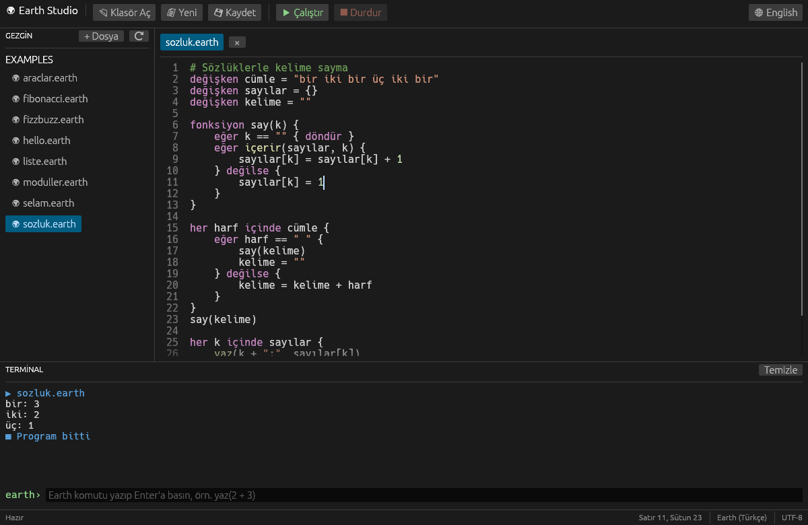
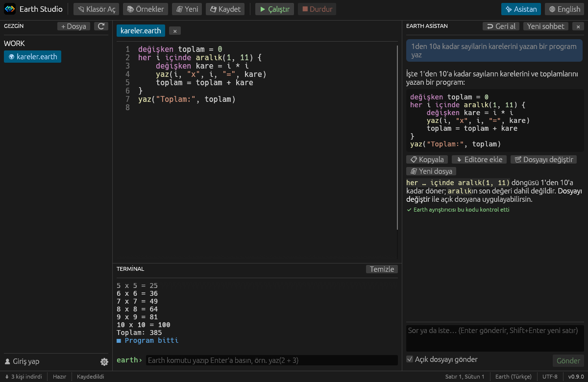

<p align="center">
  
</p>

<h1 align="center">Earth — Kendi Dünyan, Kendi Kodlaman</h1>

<p align="center">
  <a href="https://github.com/MahmutSibal/earth-lang/releases/latest"></a>
  <a href="https://github.com/MahmutSibal/earth-lang/releases"></a>
  <a href="LICENSE"></a>
</p>

Earth, **Türkçe ya da İngilizce yazılabilen** bir programlama dilidir. Her
anahtar kelimenin ve her yerleşik fonksiyonun Türkçe ve İngilizce yazımı
vardır; ikisi aynı anlama gelir, hatta aynı programda karıştırılabilir. Earth,
kendi editörü **Earth Studio** ile gelir: dosya gezgini, renkli kod editörü ve
programın çalıştığı terminal tek pencerede.

*Earth is a programming language you can write in Turkish or English: every
keyword and built-in has both spellings, and Earth answers in the language
the program is written in. It ships with its own editor, Earth Studio.*

```earth
# Türkçe
değişken ad = "Dünya"
her i içinde aralık(1, 4) {
    yaz(i, "Merhaba,", ad + "!")
}
```

```text
1 Merhaba, Dünya!
2 Merhaba, Dünya!
3 Merhaba, Dünya!
```

```earth
# English: the very same language
function fib(n) {
    if n < 2 { return n }
    return fib(n - 1) + fib(n - 2)
}
print("fib(20) =", fib(20))
```

```text
fib(20) = 6765
```

## İçindekiler

- [Neden Earth?](#neden-earth)
- [Hızlı başlangıç](#hızlı-başlangıç)
- [Earth Studio](#earth-studio)
  - [Hesap ve ayarlar](#hesap-ve-ayarlar)
  - [Earth Asistan](#earth-asistan)
- [Komut satırı: `earth`](#komut-satırı-earth)
- [Dil öğreticisi](#dil-öğreticisi)
  - [İlk program](#1-ilk-program) ·
    [Değişkenler](#2-değişkenler) ·
    [Veri türleri](#3-veri-türleri) ·
    [İşlemler](#4-işlemler) ·
    [Metinler](#5-metinler) ·
    [Koşullar](#6-koşullar) ·
    [Döngüler](#7-döngüler) ·
    [Listeler](#8-listeler) ·
    [Sözlükler](#9-sözlükler) ·
    [Fonksiyonlar](#10-fonksiyonlar) ·
    [Kullanıcıdan girdi](#11-kullanıcıdan-girdi) ·
    [Hata yakalama](#12-hata-yakalama) ·
    [Modüller](#13-modüller) ·
    [Türkçe ve İngilizce](#14-türkçe-ve-i̇ngilizce) ·
    [Sözdizimi kuralları](#15-sözdizimi-kuralları)
- [Başvuru](#başvuru)
  - [Anahtar kelimeler](#anahtar-kelimeler) ·
    [Yerleşik fonksiyonlar](#yerleşik-fonksiyonlar) ·
    [Hata mesajları](#sık-görülen-hata-mesajları)
- [Örnek programlar](#örnek-programlar)
- [Kurulum ayrıntıları](#kurulum-ayrıntıları)
- [Sık sorulan sorular](#sık-sorulan-sorular)
- [Geliştiriciler için](#geliştiriciler-için)
- [Yol haritası](#yol-haritası)
- [Lisans](#lisans)

## Neden Earth?

- **Ana dilinde programlama.** `eğer`, `iken`, `fonksiyon`, `yaz`… Programlamayı
  öğrenirken İngilizceyle aynı anda boğuşmak zorunda değilsin. Hazır
  olduğunda aynı programı `if`, `while`, `function`, `print` ile yazabilirsin.
- **Anlaşılır hata mesajları.** Hatalar, programın yazıldığı dilde, satır ve
  sütun bilgisiyle gösterilir; hatalı satır editörde kırmızıyla işaretlenir.
- **Kurulumu kolay.** Tek bir kurulum dosyası; yönetici izni istemez, Rust ya
  da başka bir araç gerektirmez. Yeni sürümler kendiliğinden gelir.
- **Küçük ama eksiksiz.** Değişkenler, koşullar, döngüler, fonksiyonlar,
  kapanışlar, listeler, sözlükler, hata yakalama, modüller ve 40'tan fazla
  yerleşik fonksiyon.
- **Açık kaynak.** Dil çekirdeği yalnızca Rust standart kütüphanesiyle yazılmış,
  okunması kolay bir yorumlayıcıdır.

## Hızlı başlangıç

1. [Releases](https://github.com/MahmutSibal/earth-lang/releases/latest)
   sayfasından **`EarthStudio-Kurulum.exe`** dosyasını indirip çalıştır. Ya da
   PowerShell'e şunu yapıştır:

   ```powershell
   irm https://raw.githubusercontent.com/MahmutSibal/earth-lang/main/install.ps1 | iex
   ```

2. Masaüstündeki **Earth Studio** simgesiyle programı aç. İlk açılışta
   `Belgeler\Earth` klasörü örnek programlarla birlikte hazırlanır.
3. **📄 Yeni** ile boş bir dosya aç, şunu yaz ve **F5**'e bas:

   ```earth
   değişken ad = girdi("Adın ne? ")
   yaz("Merhaba, " + ad + "!")
   ```

4. Terminal adını sorar; yazıp **Enter**'a bas. Program sana selam verir.
   Kaydetmek için **Ctrl+S**.

## Earth Studio



### Pencerenin bölümleri

| Bölüm | Ne işe yarar |
|---|---|
| **Araç çubuğu** (üst) | 📂 Klasör Aç, 📚 Örnekler, 📄 Yeni, 💾 Kaydet, ▶ Çalıştır, ⏹ Durdur ve arayüz dili (Türkçe/English). |
| **Gezgin** (sol) | Açık klasördeki dosyalar. Bir dosyaya tıklamak onu yeni bir sekmede açar. **+ Dosya** klasörde yeni bir `.earth` dosyası oluşturur, **⟳** listeyi yeniler. |
| **Editör** (orta) | Sekmeli kod editörü: satır numaraları ve renklendirme. Kaydedilmemiş dosyanın sekmesinde `•` görünür. Hata veren satır kırmızıyla işaretlenir. |
| **Earth Asistan** (sağ, ✨ Asistan ya da Ctrl+I) | Yapay zekâ ile sohbet: kod yazdır, kodunu açıklat, hatanı düzelttir. Ayrıntılar: [Earth Asistan](#earth-asistan). |
| **Hesap ve ayarlar** (sol alt köşe) | **👤 Giriş yap** ile Google ya da GitHub hesabınla giriş, **⚙** ile ayarlar. Ayrıntılar: [Hesap ve ayarlar](#hesap-ve-ayarlar). |
| **Terminal** (editörün altı) | Programın çıktısı burada akar. Program `girdi` ile bir şey sorduğunda cevabı alttaki satıra yazarsın. Program çalışmıyorken aynı satır bir Earth komut satırıdır (REPL). Kenarından sürükleyerek büyütülebilir. |
| **Durum çubuğu** (en alt) | Solda toplam indirme sayısı ve programın durumu (Hazır, Çalışıyor…, Girdi bekleniyor); sağda imlecin satır ve sütunu, dosyanın algılanan dili ve Studio'nun sürümü. |

### Klavye kısayolları

| Kısayol | İşlem |
|---|---|
| **F5** | Açık dosyayı çalıştır |
| **Shift+F5** | Çalışan programı durdur |
| **Ctrl+S** | Kaydet (adsız dosyada nereye kaydedileceği sorulur) |
| **Ctrl+N** | Yeni dosya |
| **Enter** (terminalde) | Girdiyi gönder ya da REPL komutunu çalıştır |
| **Tab** (editörde) | Girinti ekle |

### Program çalıştırmak

- **F5** açık sekmedeki programı çalıştırır. Diske kaydedilmiş olup değişen
  dosyalar önce otomatik kaydedilir; böylece `içe_aktar` ile kullanılan
  modüller her zaman güncel olur.
- Çıktı terminalde anında görünür; uzun süren programlarda pencere donmaz.
- Program `girdi(...)` çağırdığında durum çubuğunda **Girdi bekleniyor** yazar
  ve imleç terminale geçer.
- Sonsuz döngüye giren bir programı **⏹ Durdur** ya da **Shift+F5** keser.
  Durdurma `dene`/`yakala` ile yakalanamaz.
- Bir hata olursa terminalde kırmızıyla `✖ Hata: satır:sütun: mesaj` görünür
  ve hatalı satır editörde işaretlenir. Hata içe aktarılan bir modüldeyse o
  dosya açılır.

### Terminalde komut çalıştırmak (REPL)

Program çalışmıyorken terminalin alt satırına Earth komutları yazabilirsin.
Tanımladığın değişkenler sonraki komutlarda da kullanılabilir; bir ifadenin
değeri hemen gösterilir:

```text
earth› değişken fiyat = 120
earth› fiyat * 1.2
144
earth› büyük_harf("istanbul")
"İSTANBUL"
```

### Dosyalar ve örnekler

- Studio ilk açılışta `Belgeler\Earth` klasörünü oluşturur ve gezginde açar.
  Programlarını burada tutabilirsin.
- Örnek programlar Studio'nun içinde gelir ve `Belgeler\Earth\Örnekler`
  altına yazılır. **📚 Örnekler** onları istediğin zaman geri getirir; senin
  değiştirdiğin dosyaların üzerine yazmaz.
- **📂 Klasör Aç** ile istediğin klasörde çalışabilirsin.
- Windows'ta `.earth` dosyalarına çift tıklamak onları Studio'da açar.
- Kaydedilmemiş değişiklikler, sekme ya da pencere kapatılırken sorulur.

### Otomatik güncelleme

Earth Studio açılışta ve açık kaldığı sürece birkaç saatte bir yeni sürüm
olup olmadığına bakar. Yeni sürüm varsa:

1. Kurulum dosyasını arka planda indirir ve sürümle yayınlanan SHA-256
   özetiyle doğrular. Doğrulanamayan dosya silinir, asla çalıştırılmaz.
2. Üstte **⬆ Earth Studio X hazır** şeridini gösterir. **Yeniden başlat ve
   güncelle** güncellemeyi kurar ve Studio'yu yeni sürümle açar.
3. Şeride dokunmazsan güncelleme Studio kapatılırken sessizce kurulur; bir
   sonraki açılışta yeni sürüm çalışır.

Durum çubuğundaki sürüm numarasına (`v0.9.0` gibi) tıklamak hemen denetler.
Sol alt köşedeki **⬇ … kişi indirdi** sayacı, kurulum dosyasının GitHub'dan
toplam indirilme sayısıdır. Studio senin hakkında hiçbir bilgi göndermez;
yalnızca herkese açık sürüm bilgisini okur.

### Hesap ve ayarlar

Sol alt köşede iki düğme var:

- **👤 Giriş yap**: Google ya da GitHub hesabınla giriş yaparsın. Giriş
  isteğe bağlıdır; Studio girişsiz de tamamen çalışır.
  - **Google**: tarayıcında Google'ın kendi giriş sayfası açılır. Hesabını
    seçince Studio'ya dönersin.
  - **GitHub**: Studio kısa bir kod gösterir ve panoya kopyalar. Açılan
    `github.com/login/device` sayfasına bu kodu girip onaylarsın.

  Giriş yapınca köşede profil resmin ve adın görünür. Studio yalnızca adını,
  e-posta adresini ya da GitHub kullanıcı adını ve profil resmini okur.
  Şifren Studio'ya hiç gelmez ve hiçbir erişim anahtarı saklanmaz. Bu
  bilgiler yalnızca bu bilgisayarda tutulur; **Çıkış yap** onları siler.
- **⚙ Ayarlar**:
  - **Arayüz dili**: Türkçe ya da English.
  - **Editör yazı boyutu**: 11–24.
  - **Asistan modeli**: GPT-4.1, GPT-4.1 mini, GPT-4o ya da GPT-4o mini.
  - **Güncellemeleri otomatik indir ve kur**: Studio yeniden açılınca
    geçerli olur.

Ayarlar `%APPDATA%\Earth Studio\settings.json` dosyasında saklanır (Linux'ta
`~/.config/earth-studio`, macOS'ta `~/Library/Application Support/Earth Studio`).

### Earth Asistan



Sağdaki **Earth Asistan** paneli (araç çubuğunda **✨ Asistan** ya da
**Ctrl+I**) yapay zekâ ile sohbet etmeni sağlar: "bana bir sayı tahmin oyunu
yaz", "bu dosya ne yapıyor?", "bu döngüyü açıkla" gibi.

- **Bağlanmak:** Panelde **GitHub ile bağlan**a bas, gösterilen kodu
  `github.com/login/device` sayfasına gir. Asistan
  [GitHub Models](https://github.com/marketplace/models) kullanır; ücretsizdir
  ama günlük ve dakikalık kullanım sınırları vardır. Sınıra ulaşırsan biraz
  bekle ya da ayarlardan başka bir model seç (mini modellerin sınırı daha
  geniştir).
- **Earth'ü bilir:** Hiçbir yapay zekâ modeli Earth'ü önceden bilmez. Bu
  yüzden asistan her soruda Earth'ün anahtar kelimelerini, yerleşik
  fonksiyonlarını ve kurallarını modele verir.
- **Kodunu kontrol eder:** Cevaptaki her Earth kodu, sana gösterilmeden önce
  Earth'ün kendi ayrıştırıcısıyla denetlenir. Hatalıysa asistan hatayı
  modele gösterip kodu düzelttirir. Kontrolden geçen kodun altında
  **✔ Earth ayrıştırıcısı bu kodu kontrol etti** yazar.
- **Kodu kullanmak:** Her kod bloğunun altında **📋 Kopyala**, **⤵ Editöre
  ekle** (imlecin olduğu yere), **📝 Dosyayı değiştir** ve **📄 Yeni dosya**
  düğmeleri vardır. **Dosyayı değiştir**, uygulamadan önce neyin
  değişeceğini (eklenen satırlar yeşil, silinenler kırmızı) gösterir.
  Asistanın yaptığı son değişiklik **↩ Geri al** ile geri alınır.
- **Hatayı açıkla:** Programın hata verince terminalde **✨ Hatayı açıkla**
  düğmesi çıkar; asistan hatanın ne demek olduğunu ve nasıl düzeltileceğini
  anlatır.
- **Açık dosyayı gönder** işaretliyse açık dosyan soruyla birlikte gönderilir;
  asistan böylece kodun hakkında konuşabilir. İşareti kaldırırsan dosya
  gönderilmez.

Asistanı kullandığında sorun, sohbet geçmişi ve (işaretliyse) açık dosyan
cevap üretilmesi için GitHub Models'e gönderilir. GitHub erişim anahtarı
Windows'ta **Kimlik Bilgileri Yöneticisi**'nde şifreli saklanır; **⚙ →
GitHub bağlantısını kaldır** ya da **Çıkış yap** onu siler.

## Komut satırı: `earth`

Kurulum, Earth Studio'nun yanında komut satırı yorumlayıcısı **`earth`**'ü de
kurar. Sihirbazdaki **earth komutunu PATH'e ekle** seçeneği işaretliyse (işaretli
gelir) her yeni Komut İstemi ya da PowerShell penceresinde kullanılabilir:

| Komut | Ne yapar |
|---|---|
| `earth` | Etkileşimli kabuğu açar (Python'daki gibi). Satır satır komut yaz, sonucu hemen gör; çıkmak için `çık`. |
| `earth dosya.earth` | Dosyayı çalıştırır. Hata varsa satırı ve yerini gösterir, çıkış kodu `1` olur. |
| `earth --dil en dosya.earth` | Çıktı ve hata dilini seçer (`tr` / `en`). Seçilmezse programın dilinden anlaşılır. |
| `earth --sürüm`, `earth --yardım` | Sürümü ya da yardımı gösterir. |

```text
C:\Users\sen> earth
Earth 0.9.0 — çıkmak için 'çık' yazın
earth> değişken fiyat = 120
earth> fiyat * 1.2
144
earth> fonksiyon kare(x) {
...        döndür x * x
...    }
earth> kare(7)
49
earth> çık
```

Hatalı bir dosya çalıştırıldığında hata, programın yazıldığı dilde, satır ve
sütun bilgisiyle gösterilir:

```text
C:\Users\sen\Documents\Earth> earth hesap.earth
Earth hatası: hesap.earth:2:8: İfade bekleniyordu, ')' bulundu
  |
2 | yaz(1 +)
  |        ^
```

`.earth` dosyasına sağ tıklayıp **Terminalde çalıştır** da aynı şeyi yapar; pencere
program bitince Enter'a basana kadar açık kalır.

## Dil öğreticisi

Bu bölümdeki her örneği Earth Studio'da yeni bir dosyaya yapıştırıp **F5** ile
çalıştırabilirsin. Örneklerin altındaki kutular programın çıktısıdır.

### 1. İlk program

`yaz` (İngilizcesi `print`) verdiği değerleri aralarına boşluk koyarak yazar
ve satırı bitirir. `#` ile başlayan kısım satır sonuna kadar **yorumdur**;
Earth onu görmezden gelir.

```earth
# Bu bir yorum
yaz("Merhaba, Dünya!")
yaz("2 + 3 =", 2 + 3)
yaz()                     # boş satır
yaz("Bitti")
```

```text
Merhaba, Dünya!
2 + 3 = 5

Bitti
```

### 2. Değişkenler

Bir değişkeni ilk kez **`değişken`** (`let`) ile tanımlarsın; sonra `=` ile
yeni değer verebilirsin. Değişken adları harf ya da `_` ile başlar; Türkçe
harfler kullanılabilir.

```earth
değişken sayaç = 0
sayaç = sayaç + 1
sayaç = sayaç * 10
değişken öğrenci_adı = "Ayşe"
yaz(öğrenci_adı, sayaç)
```

```text
Ayşe 10
```

Tanımlanmamış bir değişkene değer vermek hatadır; Earth bunu yazım
hatalarını yakalamak için yapar:

```text
✖ Hata: 1:7: Tanımsız değişken 'sayac' (önce 'değişken sayac = ...' ile tanımlayın)
```

**Kapsam:** Her `{ … }` bloğu yeni bir kapsam açar. Blok içinde tanımlanan bir
değişken bloğun dışından görünmez; dışarıdaki değişkenler ise içeriden
kullanılabilir ve değiştirilebilir.

```earth
değişken toplam = 0
eğer doğru {
    değişken geçici = 5
    toplam = toplam + geçici
}
yaz(toplam)
```

```text
5
```

### 3. Veri türleri

| Tür | Örnek | Açıklama |
|---|---|---|
| **sayı** | `42`, `-7`, `3.14` | Tam ve ondalıklı sayılar aynı türdür. Tam sayılar `.0` olmadan yazılır. |
| **metin** | `"Merhaba"` | Çift tırnak içinde yazılır. |
| **mantıksal** | `doğru`, `yanlış` | İngilizcesi `true`, `false`. |
| **boş** | `boş` | "Değer yok" anlamına gelir. İngilizcesi `nil`. |
| **liste** | `[1, "iki", doğru]` | Sıralı değerler. |
| **sözlük** | `{"ad": "Ada"}` | Metin anahtarlı değerler. |
| **fonksiyon** | `yaz`, kendi fonksiyonların | Fonksiyonlar da değerdir; değişkene konabilir, başka fonksiyona verilebilir. |

`tür(x)` (`type`) bir değerin türünü söyler:

```earth
yaz(tür(42), tür("a"), tür(doğru), tür(boş), tür([1]), tür({}), tür(yaz))
```

```text
sayı metin mantıksal boş liste sözlük fonksiyon
```

Türler arasında çeviri için `metin(x)` (`str`) ve `sayı(x)` (`number`)
kullanılır. `sayı`, çevrilemeyen bir metinde hata vermek yerine `boş` döndürür;
böylece kullanıcı girdisini kolayca kontrol edebilirsin:

```earth
yaz(sayı("42") + 1, sayı("kırk iki"), metin(3.5) + "!")
```

```text
43 boş 3.5!
```

### 4. İşlemler

| İşlem | Anlamı | Örnek | Sonuç |
|---|---|---|---|
| `+` `-` `*` `/` | toplama, çıkarma, çarpma, bölme | `7 / 2` | `3.5` |
| `%` | bölümden kalan | `7 % 3` | `1` |
| `-x` | eksi | `-(2 + 3)` | `-5` |
| `==` `!=` | eşit mi, farklı mı | `2 == 2.0` | `doğru` |
| `<` `<=` `>` `>=` | karşılaştırma (sayılar ve metinler) | `"elma" < "armut"` | `yanlış` |
| `ve` (`and`) | ikisi de doğruysa doğru | `doğru ve yanlış` | `yanlış` |
| `veya` (`or`) | biri doğruysa doğru | `doğru veya yanlış` | `doğru` |
| `değil` (`not`) | tersi | `değil doğru` | `yanlış` |

**Öncelik** (yüksekten düşüğe): `-x`, `değil` → `*` `/` `%` → `+` `-` →
`<` `<=` `>` `>=` → `==` `!=` → `ve` → `veya`. Emin olmadığında parantez kullan.

```earth
yaz(2 + 3 * 4, (2 + 3) * 4, 10 % 4, 1 / 4)
yaz(3 > 2 ve 2 > 1, değil (1 == 1))
```

```text
14 20 2 0.25
doğru yanlış
```

**Doğruluk:** koşullarda yalnızca `yanlış` ve `boş` yanlış sayılır; `0`, `""`
ve `[]` doğrudur. `ve`/`veya` **kısa devre** yapar: sonuç belli olduysa sağ
taraf hiç hesaplanmaz.

**Sıfıra bölme** hata verir: `yaz(1 / 0)` → `Sıfıra bölme`.

### 5. Metinler

Metinler `+` ile birleştirilir. Bir metne herhangi bir değer eklenebilir; değer
otomatik olarak metne çevrilir.

```earth
değişken yaş = 36
yaz("Yaş: " + yaş)
yaz("Satır 1\nSatır 2")
yaz("Tırnak: \"alıntı\"  Ters bölü: \\")
```

```text
Yaş: 36
Satır 1
Satır 2
Tırnak: "alıntı"  Ters bölü: \
```

Kaçış dizileri: `\n` (yeni satır), `\t` (sekme), `\r`, `\"`, `\\`.

Metnin harflerine indeksle ulaşılır (0'dan başlar, negatif indeks sondan
sayar) ve `her … içinde` ile harf harf gezilebilir:

```earth
değişken söz = "Earth"
yaz(söz[0], söz[-1], uzunluk(söz))
yaz(büyük_harf("iğdır"), küçük_harf("IŞIK"), ters("abc"))
yaz(böl("elma,armut,kiraz", ","), içerir("Merhaba", "hab"))
yaz(değiştir("merhaba dünya", "dünya", "Earth"), "[" + kırp("  boşluk  ") + "]")
```

```text
E h 5
İĞDIR ışık cba
["elma", "armut", "kiraz"] doğru
merhaba Earth [boşluk]
```

`büyük_harf` ve `küçük_harf`, Türkçe programlarda Türkçe kurallarına uyar:
`i` → `İ`, `ı` → `I`.

### 6. Koşullar

```earth
değişken puan = 72

eğer puan >= 85 {
    yaz("Pekiyi")
} değilse eğer puan >= 70 {
    yaz("İyi")
} değilse eğer puan >= 50 {
    yaz("Geçer")
} değilse {
    yaz("Kaldı")
}
```

```text
İyi
```

`değilse`, kapanan `}` ile aynı satırda ya da bir alt satırda başlayabilir.
Kısa koşullar tek satırda yazılabilir: `eğer x < 0 { x = -x }`.

### 7. Döngüler

**`iken`** (`while`): koşul doğru olduğu sürece tekrarlar.

```earth
değişken n = 1
iken n < 100 {
    n = n * 2
}
yaz(n)
```

```text
128
```

**`her … içinde`** (`for … in`): bir listenin, metnin ya da sözlüğün her
elemanı için tekrarlar. Sayı dizileri için **`aralık`** (`range`) kullanılır:
`aralık(5)` → 0'dan 4'e, `aralık(2, 6)` → 2'den 5'e, `aralık(10, 0, -3)` → 10,
7, 4, 1.

```earth
her i içinde aralık(1, 4) {
    yaz(i, "x", i, "=", i * i)
}
her harf içinde "abc" {
    yaz(harf)
}
yaz(aralık(10, 0, -3))
```

```text
1 x 1 = 1
2 x 2 = 4
3 x 3 = 9
a
b
c
[10, 7, 4, 1]
```

**`kır`** (`break`) döngüden hemen çıkar; **`devam`** (`continue`) bu turu
atlayıp sonrakine geçer:

```earth
her i içinde aralık(10) {
    eğer i % 2 == 0 { devam }
    eğer i > 7 { kır }
    yaz(i)
}
```

```text
1
3
5
7
```

Çalışan bir döngüyü Earth Studio'da **Shift+F5** ile her zaman durdurabilirsin.

### 8. Listeler

```earth
değişken meyveler = ["elma", "armut"]
ekle(meyveler, "kiraz")             # sona ekle
meyveler[0] = "muz"                 # değiştir
yaz(meyveler, uzunluk(meyveler))
yaz(meyveler[0], meyveler[-1])      # ilk ve son eleman
yaz(sil(meyveler, 1), meyveler)     # çıkar ve döndür
yaz(içerir(meyveler, "kiraz"))
```

```text
["muz", "armut", "kiraz"] 3
muz kiraz
armut ["muz", "kiraz"]
doğru
```

Liste fonksiyonları yeni bir liste döndürür, asıl listeyi değiştirmez:

```earth
değişken sayılar = [5, 3, 8, 1]
yaz(sırala(sayılar), ters(sayılar), dilim(sayılar, 1, 3))
yaz(topla(sayılar), en_küçük(sayılar), en_büyük(sayılar))
yaz(birleştir(sayılar, " - "), [1, 2] + [3])
```

```text
[1, 3, 5, 8] [1, 8, 3, 5] [3, 8]
17 1 8
5 - 3 - 8 - 1 [1, 2, 3]
```

Var olmayan bir indeks hata verir: `[1, 2][5]` → `İndeks 5 sınırların dışında
(uzunluk 2)`.

### 9. Sözlükler

Sözlükler bir **anahtarı** (her zaman metin) bir **değere** bağlar. Eklenme
sırasını korurlar.

```earth
değişken kişi = {
    "ad": "Ada",
    "yaş": 36,
}
kişi["şehir"] = "Londra"         # ekle
kişi["yaş"] = kişi["yaş"] + 1    # güncelle
yaz(kişi)
yaz(anahtarlar(kişi), değerler(kişi))
yaz(içerir(kişi, "ad"), içerir(kişi, "soyad"))

her anahtar içinde kişi {
    yaz(anahtar, "→", kişi[anahtar])
}
```

```text
{"ad": "Ada", "yaş": 37, "şehir": "Londra"}
["ad", "yaş", "şehir"] ["Ada", 37, "Londra"]
doğru yanlış
ad → Ada
yaş → 37
şehir → Londra
```

Olmayan bir anahtarı okumak hata verir; önce `içerir` ile kontrol et.
`sil(kişi, "şehir")` bir anahtarı çıkarır.

### 10. Fonksiyonlar

**`fonksiyon`** (`function` ya da `fn`) ile tanımlanır, **`döndür`**
(`return`) ile değer verir. `döndür` olmayan fonksiyon `boş` döndürür.

```earth
fonksiyon alan(en, boy) {
    döndür en * boy
}

fonksiyon selamla(ad) {
    yaz("Merhaba, " + ad + "!")
}

yaz(alan(3, 4))
selamla("Deniz")
```

```text
12
Merhaba, Deniz!
```

**Özyineleme:** bir fonksiyon kendini çağırabilir (en fazla 1000 iç içe çağrı).

```earth
fonksiyon faktöriyel(n) {
    eğer n <= 1 { döndür 1 }
    döndür n * faktöriyel(n - 1)
}
yaz(faktöriyel(10))
```

```text
3628800
```

**Fonksiyonlar değerdir ve kapanış (closure) oluşturur:** bir fonksiyon,
tanımlandığı yerdeki değişkenleri hatırlar.

```earth
fonksiyon sayaç_yap() {
    değişken n = 0
    fonksiyon artır() {
        n = n + 1
        döndür n
    }
    döndür artır
}

değişken say = sayaç_yap()
say()
say()
yaz(say())

fonksiyon iki_kez(f, x) {
    döndür f(f(x))
}
fonksiyon kare(x) { döndür x * x }
yaz(iki_kez(kare, 3))
```

```text
3
81
```

Fonksiyonu yanlış sayıda argümanla çağırmak hatadır:
`'alan' 2 argüman bekliyor, 1 verildi`.

### 11. Kullanıcıdan girdi

**`girdi`** (`input`) bir istem yazar ve kullanıcının yazdığı satırı metin
olarak döndürür. Sayı istiyorsan `sayı(...)` ile çevir:

```earth
değişken metin_yaş = girdi("Kaç yaşındasın? ")
değişken yaş = sayı(metin_yaş)
eğer yaş == boş {
    yaz("Bu bir sayı değil.")
} değilse {
    yaz("10 yıl sonra", yaş + 10, "yaşında olacaksın.")
}
```

Earth Studio'da program girdi beklerken durum çubuğunda **Girdi bekleniyor**
yazar; cevabını terminale yazıp **Enter**'a basarsın.

### 12. Hata yakalama

Hata verebilecek kodu **`dene`** (`try`) içine, hata olursa çalışacak kodu
**`yakala`** (`catch`) içine yaz. Kendi hatanı **`fırlat`** (`throw`) ile
oluşturabilirsin.

```earth
fonksiyon böl_güvenli(a, b) {
    eğer b == 0 { fırlat "Sıfıra bölünemez" }
    döndür a / b
}

dene {
    yaz(böl_güvenli(10, 2))
    yaz(böl_güvenli(1, 0))
    yaz("Bu satır çalışmaz")
} yakala hata {
    yaz("Yakalandı:", hata)
}

dene {
    yaz([1, 2, 3][10])
} yakala hata {
    yaz("Earth'ün kendi hatası da yakalanır:", hata)
}
yaz("Program devam ediyor")
```

```text
5
Yakalandı: Sıfıra bölünemez
Earth'ün kendi hatası da yakalanır: İndeks 10 sınırların dışında (uzunluk 3)
Program devam ediyor
```

- `fırlat` her türlü değeri fırlatabilir; örneğin bir sözlük:
  `fırlat {"kod": 404, "mesaj": "Bulunamadı"}`. `yakala` o değeri olduğu gibi
  alır.
- Earth'ün kendi hataları (sıfıra bölme, olmayan indeks…) yakalandığında hata
  değişkeni mesajı metin olarak taşır.
- `yakala`dan sonraki değişken adı isteğe bağlıdır: `} yakala { … }`.
- Yakalanmayan bir hata programı durdurur:
  `Yakalanmamış hata: Sıfıra bölünemez`.

### 13. Modüller

Büyüyen programları birden fazla dosyaya bölebilirsin. **`içe_aktar`**
(`import`) başka bir `.earth` dosyasını çalıştırır ve tanımladığı değişkenleri
ve fonksiyonları kullanılabilir yapar.

```earth
# geometri.earth
değişken PI = 3.14159
fonksiyon daire_alanı(r) {
    döndür PI * r * r
}
```

```earth
# ana.earth (aynı klasörde)
içe_aktar "geometri.earth"
yaz(daire_alanı(2))
```

- Yol, içe aktaran dosyanın bulunduğu klasöre göredir; alt klasörler de
  olur: `içe_aktar "araçlar/metin.earth"`.
- Her modül, kaç kez içe aktarılırsa aktarılsın, bir kez çalışır.
- Modül kendi kapsamında çalışır: içe aktaran dosyanın değişkenlerini göremez.
- Birbirini içe aktaran dosyalar (döngüsel içe aktarma) hata verir.
- Modüldeki bir hata, modülün dosya adı ve satırıyla gösterilir.

### 14. Türkçe ve İngilizce

Her anahtar kelimenin ve yerleşik fonksiyonun Türkçe, ASCII-Türkçe (Türkçe
harfsiz klavyeler için) ve İngilizce yazımı vardır. Hepsi aynı anlama gelir ve
aynı programda karıştırılabilir:

```earth
değişken liste = [3, 1, 2]
for x in sirala(liste) {
    eger x > 1 { print("büyük:", x) }
}
```

```text
büyük: 2
büyük: 3
```

**Çıktının dili:** Earth, programın çoğunlukla hangi dilin anahtar
kelimeleriyle yazıldığına bakar ve o dilde cevap verir. Türkçe bir program
`doğru`, `boş`, `liste` ve Türkçe hata mesajları görür; İngilizce bir program
`true`, `nil`, `list` ve İngilizce hata mesajları görür:

```earth
print(1 < 2, nil, type([]))
```

```text
true nil list
```

Earth Studio'nun durum çubuğu, açık dosyanın hangi dilde algılandığını
gösterir.

### 15. Sözdizimi kuralları

- Her satıra bir komut yazılır. Aynı satırda birden fazla komut için `;`
  kullanılır: `değişken a = 1; değişken b = 2`.
- Bloklar `{ … }` ile yazılır; girinti zorunlu değildir ama okunabilirlik için
  önerilir.
- Parantez `( )`, köşeli parantez `[ ]` ve sözlük `{ }` içindeki ifadeler birden
  fazla satıra yayılabilir; listelerde ve sözlüklerde sondaki virgül serbesttir.
- `#` ile başlayan kısım satır sonuna kadar yorumdur.
- `döndür` yalnızca fonksiyonda, `kır`/`devam` yalnızca döngüde kullanılabilir.
  Bu hatalar program çalışmadan önce yakalanır.

## Başvuru

### Anahtar kelimeler

| Türkçe | ASCII | English | Anlamı |
|---|---|---|---|
| `değişken` | `degisken` | `let` | değişken tanımlama |
| `eğer` | `eger` | `if` | koşul |
| `değilse` | `degilse` | `else` | aksi halde |
| `iken` | | `while` | koşul doğru iken döngü |
| `her … içinde` | `icinde` | `for … in` | liste, metin ya da sözlük üzerinde döngü |
| `kır` | `kir` | `break` | döngüden çıkma |
| `devam` | | `continue` | sonraki tura geçme |
| `fonksiyon` | | `function`, `fn` | fonksiyon tanımlama |
| `döndür` | `dondur` | `return` | fonksiyondan değer döndürme |
| `dene` / `yakala` | | `try` / `catch` | hata yakalama |
| `fırlat` | `firlat` | `throw` | hata fırlatma |
| `içe_aktar` | `ice_aktar` | `import` | başka bir dosyayı yükleme |
| `ve` / `veya` / `değil` | `degil` | `and` / `or` / `not` | mantıksal işlemler |
| `doğru` / `yanlış` | `dogru` / `yanlis` | `true` / `false` | mantıksal değerler |
| `boş` | `bos` | `nil` | değer yok |

### Yerleşik fonksiyonlar

`?` ile işaretli parametreler isteğe bağlıdır. Türkçe adların ASCII yazımları
da geçerlidir (`aralik`, `buyuk_harf`, `karekok`…).

**Temel**

| Türkçe | English | Açıklama | Örnek → sonuç |
|---|---|---|---|
| `yaz(a, b, …)` | `print` | Değerleri boşlukla ayırıp yazar, satırı bitirir. | `yaz("a", 1)` → `a 1` |
| `girdi(istem?)` | `input` | Bir satır okur; girdi bittiyse `boş`. | `girdi("Ad? ")` |
| `uzunluk(x)` | `len` | Metin, liste ya da sözlüğün uzunluğu. | `uzunluk("abc")` → `3` |
| `aralık(son)` / `aralık(baş, son, adım?)` | `range` | Sayı listesi; `son` dahil değil. | `aralık(3)` → `[0, 1, 2]` |
| `tür(x)` | `type` | Değerin türü. | `tür(1)` → `"sayı"` |
| `metin(x)` | `str` | Değeri metne çevirir. | `metin(5)` → `"5"` |
| `sayı(x)` | `number` | Metni sayıya çevirir; olmazsa `boş`. | `sayı("2.5")` → `2.5` |

**Metin**

| Türkçe | English | Açıklama | Örnek → sonuç |
|---|---|---|---|
| `büyük_harf(m)` | `upper` | Büyük harf (Türkçe programlarda `i`→`İ`). | `büyük_harf("iz")` → `"İZ"` |
| `küçük_harf(m)` | `lower` | Küçük harf (Türkçe programlarda `I`→`ı`). | `küçük_harf("IŞIK")` → `"ışık"` |
| `kırp(m)` | `trim` | Baştaki ve sondaki boşlukları siler. | `kırp(" a ")` → `"a"` |
| `böl(m, ayırıcı?)` | `split` | Parçalara ayırır; ayırıcı yoksa boşluklardan. | `böl("a b")` → `["a", "b"]` |
| `birleştir(liste, ayırıcı?)` | `join` | Elemanları metin olarak birleştirir. | `birleştir([1, 2], "-")` → `"1-2"` |
| `değiştir(m, eski, yeni)` | `replace` | Geçen her `eski`yi `yeni` yapar. | `değiştir("aa", "a", "b")` → `"bb"` |
| `içerir(m, parça)` | `contains` | Metin parçayı içeriyor mu? | `içerir("abc", "b")` → `doğru` |
| `ters(m)` | `reverse` | Metni ters çevirir. | `ters("abc")` → `"cba"` |
| `dilim(m, baş, son?)` | `slice` | `baş`tan `son`a kadarki parça. | `dilim("Merhaba", 0, 3)` → `"Mer"` |

**Liste ve sözlük**

| Türkçe | English | Açıklama | Örnek → sonuç |
|---|---|---|---|
| `ekle(liste, değer)` | `push` | Listenin sonuna ekler. | `ekle(l, 4)` |
| `sil(liste, indeks)` / `sil(sözlük, anahtar)` | `remove` | Elemanı çıkarır ve döndürür. | `sil([7, 8], 0)` → `7` |
| `içerir(x, aranan)` | `contains` | Listede eleman, sözlükte anahtar var mı? | `içerir([1, 2], 2)` → `doğru` |
| `anahtarlar(sözlük)` | `keys` | Anahtarların listesi. | `anahtarlar({"a": 1})` → `["a"]` |
| `değerler(sözlük)` | `values` | Değerlerin listesi. | `değerler({"a": 1})` → `[1]` |
| `sırala(liste)` | `sort` | Sıralanmış yeni liste (hepsi sayı ya da hepsi metin). | `sırala([3, 1])` → `[1, 3]` |
| `ters(liste)` | `reverse` | Ters çevrilmiş yeni liste. | `ters([1, 2])` → `[2, 1]` |
| `dilim(liste, baş, son?)` | `slice` | Parça; negatif indeks sondan sayar. | `dilim([1, 2, 3], -2)` → `[2, 3]` |
| `topla(liste)` | `sum` | Sayıların toplamı. | `topla([1, 2, 3])` → `6` |

**Matematik**

| Türkçe | English | Açıklama | Örnek → sonuç |
|---|---|---|---|
| `mutlak(x)` | `abs` | Mutlak değer. | `mutlak(-3)` → `3` |
| `karekök(x)` | `sqrt` | Karekök. | `karekök(16)` → `4` |
| `üs(x, y)` | `pow` | x üzeri y. | `üs(2, 10)` → `1024` |
| `yuvarla(x, basamak?)` | `round` | Yuvarlar; isteğe bağlı ondalık basamak. | `yuvarla(2.567, 2)` → `2.57` |
| `taban(x)` / `tavan(x)` | `floor` / `ceil` | Aşağı / yukarı yuvarlar. | `taban(2.7)` → `2` |
| `en_küçük(…)` / `en_büyük(…)` | `min` / `max` | Sayıların ya da bir listenin en küçüğü / en büyüğü. | `en_büyük(3, 9, 2)` → `9` |
| `rastgele()` | `random` | 0 ile 1 arasında rastgele kesir. | `rastgele()` → `0.42…` |
| `rastgele(n)` / `rastgele(a, b)` | `random` | `[0, n)` ya da `[a, b]` aralığında rastgele tam sayı. | `rastgele(1, 6)` → zar |

### Sık görülen hata mesajları

| Mesaj | Ne demek, ne yapmalı |
|---|---|
| `Tanımsız değişken 'x'` | `x` hiç tanımlanmamış ya da adı yanlış yazılmış. İlk kullanımda `değişken x = …` yaz. |
| `')' bekleniyordu, … bulundu` | Bir parantez kapatılmamış ya da fazladan bir şey yazılmış. Belirtilen sütuna bak. |
| `Satır sonu bekleniyordu` | Aynı satıra iki komut yazılmış. Alt satıra geç ya da araya `;` koy. |
| `Blok kapatılmamış: '}' bekleniyordu` | Bir `{` için `}` eksik. |
| `'+' işlemi 'sayı' ve 'mantıksal' türleri arasında yapılamaz` | Bu iki tür bu işlemle kullanılamaz. Gerekirse `metin(…)` ya da `sayı(…)` ile çevir. |
| `Sıfıra bölme` | Bir sayı sıfıra bölünmüş. Bölmeden önce kontrol et. |
| `İndeks 5 sınırların dışında (uzunluk 2)` | Listede ya da metinde olmayan bir sıraya erişilmiş. |
| `Sözlükte "x" anahtarı yok` | Okumadan önce `içerir(sözlük, "x")` ile kontrol et. |
| `'f' 2 argüman bekliyor, 1 verildi` | Fonksiyon yanlış sayıda değerle çağrılmış. |
| `'kır' yalnızca bir döngünün içinde kullanılabilir` | `kır`/`devam` döngü dışında; `döndür` fonksiyon dışında kullanılmış. |
| `Çok derin özyineleme` | Bir fonksiyon kendini 1000'den fazla iç içe çağırmış; çoğunlukla durma koşulu eksiktir. |
| `Program durduruldu` | Program **Durdur** ile kesilmiş. |

## Örnek programlar

Bu örnekler Earth Studio'nun içinde gelir (**📚 Örnekler**) ve depoda
[`examples/`](examples) klasöründe de bulunur.

| Dosya | Gösterdiği |
|---|---|
| [`hello.earth`](examples/hello.earth) | Türkçe ve İngilizce `yaz` |
| [`fizzbuzz.earth`](examples/fizzbuzz.earth) | Koşullar ve `her … içinde` döngüsü |
| [`fibonacci.earth`](examples/fibonacci.earth) | İngilizce anahtar kelimeler, özyineleme, listeler |
| [`liste.earth`](examples/liste.earth) | Listeler, fonksiyonlar ve kapanışlar |
| [`sozluk.earth`](examples/sozluk.earth) | Sözlüklerle kelime sayma |
| [`selam.earth`](examples/selam.earth) | Kullanıcıdan girdi okuma |
| [`moduller.earth`](examples/moduller.earth) | Modül içe aktarma, hata yakalama, metin fonksiyonları |
| [`araclar.earth`](examples/araclar.earth) | `moduller.earth`'ün içe aktardığı modül |

## Kurulum ayrıntıları

### Windows

[Releases](https://github.com/MahmutSibal/earth-lang/releases/latest)
sayfasındaki **`EarthStudio-Kurulum.exe`** şu adımlarla kurar:

1. Hoş geldin ekranı (kurulum, Windows'un diline göre Türkçe ya da İngilizce açılır)
2. Kurulum klasörü — varsayılan `%LOCALAPPDATA%\Programs\Earth Studio`;
   **yönetici izni gerekmez**
3. Seçenekler (hepsi işaretli gelir):
   - **Masaüstü simgesi oluşturulsun**
   - **.earth dosyalarını Earth Studio ile aç**: çift tıklanan `.earth`
     dosyası Studio'da açılır; sağ tık menüsüne **Terminalde çalıştır** eklenir.
   - **earth komutunu PATH'e ekle**: komut isteminde `earth` ve
     `earth dosya.earth` çalışır.
4. İlerleme çubuğuyla kurulum
5. "Earth Studio'yu çalıştır" ile bitiş

**Güncelleme:** Earth Studio zaten kuruluysa kurulum bunu fark eder. Hoş geldin
ekranında kurulu sürümü ve yeni sürümü gösterir, klasör sorusunu atlar ve
mevcut kurulumu yerinde günceller. Önceki seçeneklerin ve programların
korunur; açık olan Studio kapatılır. Bir seçeneğin işaretini kaldırıp
güncellersen o seçeneğin yaptığı da geri alınır.

Kurulumdan sonra:

- Başlat menüsünde ve masaüstünde **Earth Studio** kısayolu bulunur.
- Kurulum klasöründe yalnızca `earth-studio.exe`, komut satırı için
  `earth.exe` ve kaldırıcı vardır; dil ve örnekler programların içine gömülüdür.
- Kaldırmak için **Ayarlar → Uygulamalar → Earth Studio**. Kaldırma, PATH
  kaydını ve dosya ilişkilendirmesini de siler; `Belgeler\Earth` klasöründeki
  programlarına dokunmaz.

**Tek satırla kurulum:** PowerShell'e yapıştır. Aynı kurulum dosyasını indirir,
SHA-256 özetini doğrular, bütün seçeneklerle sessizce kurar. Bu yolla
indirilen dosyalar Windows SmartScreen uyarısı göstermez.

```powershell
irm https://raw.githubusercontent.com/MahmutSibal/earth-lang/main/install.ps1 | iex
```

**Doğrulama:** Releases sayfasındaki `SHA256SUMS.txt` dosyasındaki özet ile
indirdiğin dosyanın özetini karşılaştırabilirsin:

```powershell
Get-FileHash EarthStudio-Kurulum.exe
```

### Linux ve macOS

Releases sayfasındaki `earth-studio-linux-x64.tar.gz` ya da
`earth-studio-macos-arm64.tar.gz` arşivini aç ve `earth-studio` programını
çalıştır. Arşivdeki `earth` komut satırı yorumlayıcısını PATH'teki bir klasöre
(örneğin `~/.local/bin`) kopyalarsan terminalde `earth` ve `earth dosya.earth`
kullanılabilir. Bu sistemlerde Studio yeni sürümleri haber verir ve indirme sayfasına
yönlendirir.

## Sık sorulan sorular

**Windows "Windows bilgisayarınızı korudu" / "bilinmeyen yayımcı" diyor.**
Kurulum dosyası henüz dijital olarak imzalı olmadığı için tarayıcıdan indirilen
her yeni program gibi bu uyarıyı alabilir; zararlı olduğu anlamına gelmez.
**Ek bilgi → Yine de çalıştır** ile devam edebilir ya da uyarı göstermeyen tek
satırlık PowerShell kurulumunu kullanabilirsin. İmzalama planı:
[docs/imzalama.md](docs/imzalama.md).

**Programlarım nerede duruyor?** Varsayılan olarak `Belgeler\Earth`
klasöründe. İstediğin klasörü **📂 Klasör Aç** ile açabilirsin.

**Türkçe karakterler bozuk görünüyor.** Dosyayı başka bir editörle
yazdıysan **UTF-8** olarak kaydet. Earth Studio dosyaları her zaman UTF-8
kaydeder.

**Türkçe harfsiz bir klavyem var.** Her anahtar kelimenin ASCII yazımı
vardır: `eger`, `degilse`, `degisken`, `dondur`, `icinde`, `buyuk_harf`…

**Otomatik güncellemeyi kapatmak istiyorum.** `EARTH_STUDIO_NO_UPDATE`
ortam değişkenini `1` yap. Kurumsal bilgisayarlar için uygundur.

**Studio açılmıyor ya da pencere boş görünüyor.** Studio önce DirectX 12
ile çizmeyi dener, olmazsa kendini OpenGL ile yeniden başlatır. Yine de
sorun olursa ekran kartı sürücülerini güncelle ya da
`EARTH_STUDIO_RENDERER=glow` ortam değişkenini tanımla.

**Studio benim hakkımda bilgi gönderiyor mu?** Hayır. Yalnızca GitHub'daki
herkese açık sürüm bilgisini ve indirme sayısını okur. Giriş yaparsan
profil bilgilerin sadece bu bilgisayarda saklanır. Tek istisna Earth
Asistan'dır: onu kullandığında sorun ve (istersen) açık dosyan cevap için
GitHub Models'e gönderilir.

**Bir hata buldum ya da önerim var.**
[Issues](https://github.com/MahmutSibal/earth-lang/issues) sayfasından
bildirebilirsin.

## Geliştiriciler için

### Kaynaktan çalıştırmak

[Rust](https://www.rust-lang.org/tools/install) kur, sonra:

```bash
cargo run -p earth-studio                                # Earth Studio'yu aç
cargo run -p earth-studio -- examples/fizzbuzz.earth     # bir dosyayla aç
cargo run -p earth                                       # komut satırı kabuğu
cargo run -p earth -- examples/fizzbuzz.earth            # dosyayı terminalde çalıştır
```

Windows'ta `link.exe not found` hatası alırsan **Visual Studio Build Tools**
içinden **Desktop development with C++** iş yükünü kur.

### Kontroller

```bash
cargo fmt --all -- --check
cargo clippy --workspace --all-targets -- -D warnings
cargo test --workspace
```

Testler; dilin kendisini, `examples/` altındaki her programı ve bu
README'deki her Earth örneğini kapsar. README'deki bir örneğin hemen
ardından gelen `text` bloğu, o örneğin beklenen çıktısıdır ve testlerde
karşılaştırılır.

### Proje yapısı

```text
earth-lang/
├── src/                  dil çekirdeği (yalnızca Rust standart kütüphanesi)
│   ├── keywords.rs       çok dilli sözlük: anahtar kelimeler ve yerleşikler
│   ├── messages.rs       kullanıcıya gösterilen bütün mesajlar, her dilde
│   ├── lexer.rs          kaynak metni satır/sütun bilgili token'lara ayırır
│   ├── parser.rs, ast.rs özyinelemeli iniş ayrıştırıcısı ve sözdizimi ağacı
│   ├── interpreter.rs    ağaç gezen yorumlayıcı, kapsamlar, modüller
│   ├── value.rs          değerler, listeler, sözlükler
│   ├── stdlib.rs         girdi/çıktı dışındaki yerleşik fonksiyonlar
│   └── main.rs           komut satırı: earth ve earth dosya.earth
├── studio/               Earth Studio (egui)
│   └── src/              arayüz, renklendirme, çalıştırıcı, güncelleyici,
│                         giriş, ayarlar, Earth Asistan
├── examples/             örnek programlar (Studio'ya gömülür)
├── editors/vscode/       VS Code sözdizimi renklendirme eklentisi
├── windows/              simge, manifest, Inno Setup kurulum betiği
├── install.ps1           tek satırlık Windows kurulumu
└── docs/                 görseller ve imzalama rehberi
```

### Yeni sürüm yayınlamak

1. `Cargo.toml` ve `studio/Cargo.toml` içindeki `version`'ı artır.
2. Bir etiket gönder: `git tag v0.7.0 && git push origin v0.7.0`.
3. `release` workflow'u Windows kurulum dosyasını, Linux/macOS arşivlerini ve
   `SHA256SUMS.txt`'yi Releases sayfasına ekler.
4. Kullanıcıların Earth Studio'su yeni sürümü kendiliğinden bulur ve kurar.

GitHub Actions kullanılamıyorsa Windows kurulum dosyası Linux'ta da üretilebilir
(MinGW-w64, Wine ve Wine altında kurulu
[Inno Setup](https://jrsoftware.org/isinfo.php) gerekir):

```bash
rustup target add x86_64-pc-windows-gnu
cargo build --release --workspace --target x86_64-pc-windows-gnu
cd windows && wine 'C:\InnoSetup\ISCC.exe' /DAppVersion=0.7.0 \
  '/DBinDir=..\target\x86_64-pc-windows-gnu\release' installer.iss
cd Output && sha256sum EarthStudio-Kurulum.exe > SHA256SUMS.txt
```

Ardından Releases'ta yeni bir sürüm oluşturup `EarthStudio-Kurulum.exe` ve
`SHA256SUMS.txt`'yi yükle. **`SHA256SUMS.txt` olmadan Studio güncellemeyi
güvenlik gereği kurmaz.**

### Katkı rehberi

**Yeni bir insan dili eklemek**

1. `src/keywords.rs` içinde `Lang` enum'una yeni dili ekle; `KEYWORDS` ve
   `BUILTINS` tablolarına o dilin yazımları için yeni bir sütun aç.
2. `src/messages.rs` içinde tür adlarını ve mesajları o dile çevir; derleyici
   eksik çevirileri gösterir. `studio/src/texts.rs` içinde arayüz metinlerini
   ekle.

Lexer, parser ve yorumlayıcıda değişiklik gerekmez.
`spellings_are_unique_and_complete` testi çakışan ya da eksik yazımları yakalar.

**Yeni bir yerleşik fonksiyon eklemek**

1. `src/keywords.rs` içinde `Builtin` enum'una bir varyant, `BUILTINS`
   tablosuna yazımlarını ekle.
2. `src/stdlib.rs` içinde `arity` ve `call` fonksiyonlarına argüman sayısını
   ve davranışı ekle.
3. Editör renklendirmesini yeniden üret:
   `python3 editors/vscode/gen_grammar.py src/keywords.rs editors/vscode/syntaxes/earth.tmLanguage.json`
4. Testler ekle ve bu README'deki tabloyu güncelle.

**Yeni bir sözdizimi eklemek:** sırasıyla `keywords.rs` (gerekirse anahtar
kelime), `lexer.rs` (yeni semboller), `ast.rs`, `parser.rs` ve
`interpreter.rs` dosyalarını genişlet.

**VS Code eklentisi:** `editors/vscode` klasörü VS Code için sözdizimi
renklendirme eklentisidir; kurulumu
[editors/vscode/README.md](editors/vscode/README.md) dosyasında.

## Yol haritası

- [x] Değişkenler, ifadeler, koşullar, döngüler
- [x] Fonksiyonlar, özyineleme ve kapanışlar
- [x] Listeler ve sözlükler
- [x] Konum bilgili, çok dilli hata mesajları
- [x] Standart kütüphane (metin, matematik, liste)
- [x] Hata yakalama (`dene` / `yakala` / `fırlat`)
- [x] Modüller (`içe_aktar`)
- [x] Earth Studio: gezgin, sekmeli editör, terminal, REPL
- [x] Windows kurulum programı, otomatik güncelleme
- [x] Komut satırı: `earth` kabuğu ve `earth dosya.earth`
- [x] Earth Asistan: GitHub Models ile sohbet, ayrıştırıcıyla denetlenen kod
- [x] VS Code sözdizimi renklendirme
- [ ] Dosya okuma ve yazma
- [ ] Sınıflar / kullanıcı tanımlı türler
- [ ] Daha fazla insan dili
- [ ] Studio'da otomatik tamamlama ve hata ayıklayıcı
- [ ] Daha hızlı çalışma için bytecode derleyici

## Lisans

Earth [MIT lisansı](LICENSE) ile dağıtılır: ücretsizdir, kaynak kodu açıktır;
kullanabilir, değiştirebilir ve paylaşabilirsin.
